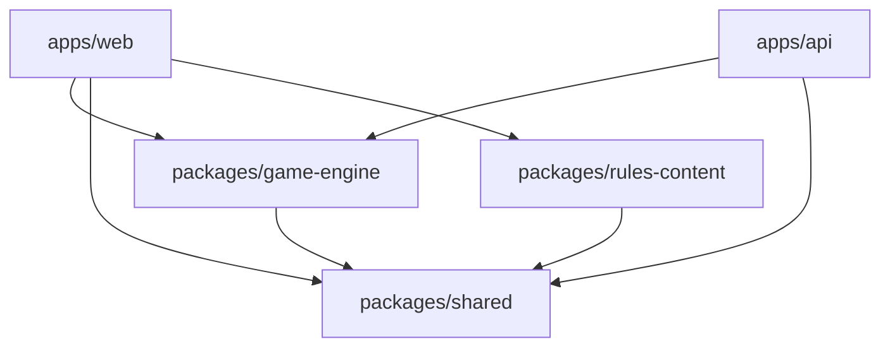
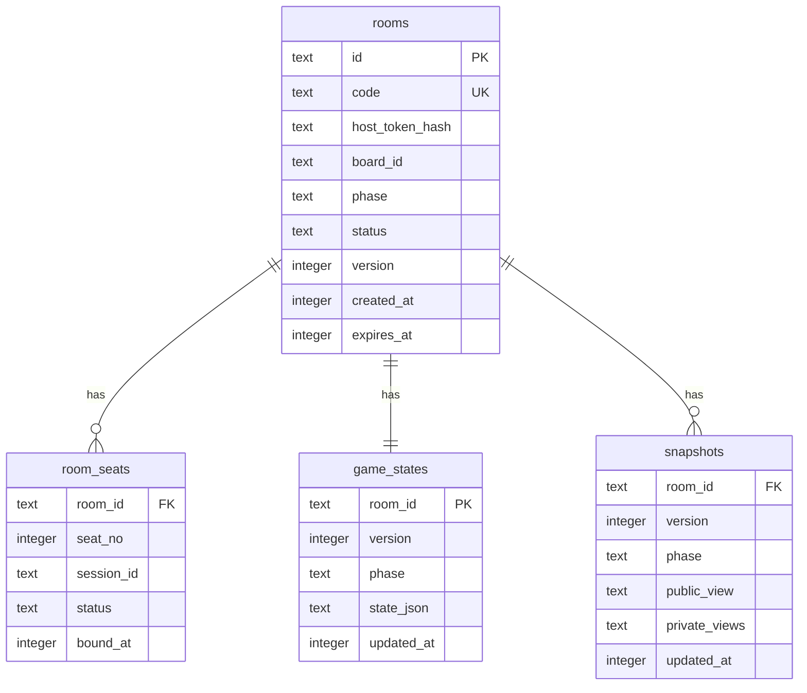

# 技术架构

- 版本：v1.2
- 日期：2026-11-25
- PRD 基线：v1.3.1（P0 本轮；P1 下一迭代）
- 适用范围：移动端优先 Web 应用；P0 单机主持 + 个人助手 + AI 中转；P1 联机预留
- 文档状态：活跃（步骤 3 已验收，2026-11-25）；阶段与验收状态以 [project-progress.md](../plan/project-progress.md) 为准
- 关联：[API 契约](api-contract.md)、[开发环境信息](dev-info.md)、[ADR 索引](#14-adr-索引)

## 1. 目标、范围与约束

**目标**

- P0 在浏览器本地完成开局、发牌、夜间/白天引导、判定、结算与个人助手；页面加载后断网可继续。
- AI 通过 BYOK + 后端中转，Key 不落库、不写日志。
- P1 预留配对码联机、WebSocket 快照、服务端视图过滤、PWA。

**约束**

- 移动端优先（CSS 360–440px，320 兼容地板）；桌面仅兼容。
- 无账号体系；匿名会话 + 房间令牌。
- 12 人固定、两个板子、屠边；规则以 PRD 附录 A 为唯一口径。
- 单服务器部署；Node 单进程提供静态/API/WS；HTTPS + 域名；境内 ICP 备案；数据库不对外。
- 不使用 Nginx/Docker（2026-11-25 用户决定）；TLS 由 Node HTTPS 或云负载均衡终止。
- 不使用微信小程序/原生 App；不依赖应用商店。

## 2. 系统上下文与总体架构

### 2.1 系统上下文

```mermaid
flowchart LR
  H[主持人手机浏览器] -->|HTTPS| N[Node/Fastify]
  P[玩家手机浏览器] -->|HTTPS| N
  N -->|@fastify/static| W[React SPA]
  N -->|/api| A[Fastify API]
  A -->|AI Relay| X[玩家自配 AI Provider]
  A -->|P1 房间/快照| D[(SQLite)]
  A -->|P1 WebSocket| P
```

外部参与者：主持人（上帝）、玩家（独立/联机）、玩家自配的 Chat Completions 服务。系统边界：浏览器前端、Node/Fastify（静态 + API + P1 WebSocket）、SQLite（P1）。AI 供应商在系统边界外，失败不影响 P0 主持。

### 2.2 部署视图

```text
Browser ──HTTPS──> Node/Fastify ──┬── /            → apps/web 静态构建（@fastify/static）
                                  ├── /api/*       → Fastify API
                                  └── /ws/*        → Socket.IO（P1）
                                         │
                                         ├── AI Provider（P0，出站 HTTPS）
                                         └── SQLite 文件（P1）
```

- 不使用 Nginx/Docker；Node 直接提供静态资源、API 与 WebSocket。
- TLS 由 Node HTTPS 直接终止，或由云负载均衡/CDN 终止后回源 Node 3000。

### 2.3 架构原则

- **P0 本地优先**：规则引擎与对局状态在浏览器运行，不依赖后端。
- **规则唯一权威**：`packages/game-engine` 拥有规则、状态流转与胜负判定；UI、API、仓储不得复制规则。
- **服务端过滤**：P1 只向玩家下发其角色可见的视图，原始全局状态不下发。
- **最简可靠**：单服务器、SQLite、Socket.IO；不引入 Redis/消息队列/微服务。
- **契约共享**：TypeScript 类型 + Zod 契约放在 `packages/shared`，前后端共用。

## 3. 需求承接与覆盖矩阵

| 需求/约束 | 目标或验收 | 架构承接 | 验证方式 | 状态 |
| --- | --- | --- | --- | --- |
| P0-1 规则与攻略 | AC-4 | `packages/rules-content` + `apps/web` 规则页 | 内容核对 + AC-4 | 已承接 |
| P0-2 开局设置 | AC-1/AC-4 | `game-engine` SETUP + web | 单测 + E2E | 已承接 |
| P0-3 双模式发牌 | AC-2/AC-6 | `game-engine` DEAL + web 遮罩/二次揭示 | E2E 侧视测试 | 已承接 |
| P0-4 夜间引导 | AC-3/AC-4 | `game-engine` NIGHT + web 步骤卡/口播 | 规则单测 + E2E | 已承接 |
| P0-5 白天引导 | AC-3/AC-4 | `game-engine` SHERIFF/DAWN/SPEECH/VOTE/SETTLE | 规则单测 + E2E | 已承接 |
| P0-6 自动判定 | AC-3 | `game-engine` 规则/冲突/胜负 | 附录 A 用例 | 已承接 |
| P0-7 结算复盘 | AC-1/AC-11 | `game-engine` RESULT + web | E2E | 已承接 |
| P0-8 个人助手 | AC-8 | `apps/web` 本地存储 + 助手 UI | E2E + IndexedDB 检查 | 已承接 |
| P0-9 独立模式 | AC-7 | `apps/web` 本地存储 + 局势录入 | E2E | 已承接 |
| P0-10 AI 辅助 | AC-9/AC-10 | `apps/api` `/ai/relay` + web | 契约测试 + 失败用例 | 已承接 |
| P0-11 本地数据 | AC-11 | IndexedDB/localStorage | 刷新/清空测试 | 已承接 |
| P0-12 屏幕常亮 | AC-16 | web Wake Lock + fallback | 真机 hide/show | 已承接 |
| NFR 移动端性能 | AC-16/AC-17 | Vite 代码分割、Tailwind、SVG/系统字体 | Lighthouse + 真机 | 已承接 |
| NFR 可访问性 | 走查 + 真机 | 触控 ≥44px、对比度 ≥4.5:1、系统字体放大不截断 | AC-16 走查 + T-021 | 已承接 |
| NFR 安全/隐私 | 安全用例 | 匿名会话、CSRF、CORS、CSP、SSRF、服务端过滤 | 安全测试 | 已承接 |
| NFR AI 时效/限频 | AC-10 | API 超时、响应上限、限频 | 契约/故障注入 | 已承接 |
| P1 联机/PWA/术语/笔记 | AC-12~AC-15、AC-19 | `apps/api` rooms + Socket.IO + SQLite；web P1 | P1 验收 | 预留（下一迭代） |
| 约束：无账号/非小程序/12 人/规则口径 | 走查 | 匿名会话、Web SPA、固定板子、附录 A | 架构评审 | 已承接 |

未承接项：无。P1 项明确为下一迭代，不进入 v1.3.1 P0 验收。

## 4. 模块划分与依赖方向

| 模块 | 职责 | 公开契约 | 允许依赖 | 禁止 |
| --- | --- | --- | --- | --- |
| `apps/web` | UI、主持流程编排、本地持久化、AI 上下文组装 | React 页面/组件、Zustand store | game-engine、shared、rules-content | 直接 import `apps/api` 内部；向玩家端下发原始状态 |
| `packages/game-engine` | 规则、状态机、夜间/白天动作、冲突、胜负、视图生成 | 纯函数/类型：createGame、applyAction、checkWin、buildViews | shared | DOM、网络、存储、UI |
| `packages/shared` | API 契约、DTO、错误码、视图类型 | Zod schema、TS 类型 | 无（仅标准库） | 业务规则、UI |
| `packages/rules-content` | 板子/角色/流程/术语静态内容 | JSON/TS 常量 | shared | 规则计算 |
| `apps/api` | AI 中转、P1 房间/认证/WS、用 game-engine 校验完整状态并生成视图、DB 访问 | HTTP/WS 契约（api-contract.md） | game-engine、shared、Drizzle/SQLite | UI、直接操作浏览器存储、把原始状态下发给玩家 |
| `infra`（部署） | Node 进程、systemd/PM2、TLS、备份 | 部署文档/配置 | — | 业务逻辑 |

依赖方向：



- 跨模块只通过公开函数/类型/契约；禁止循环依赖。
- 规则所有者是 `game-engine`；API 只做输入校验、鉴权、持久化与编排；仓储不回调业务服务。
- P1 服务端用同一 `game-engine` 校验主持端写入的完整状态，并由服务端生成玩家视图，避免“主持端过滤”冒充“服务端过滤”。

## 5. 核心链路与降级

### 5.1 P0 单机主持

```text
用户操作 → React 页面 → Zustand action → game-engine 纯函数
        → 结果/新状态 → IndexedDB 落库（每步） → 页面渲染
```

- 规则判定、状态推进、胜负检查全部在 `game-engine`。
- 每一步落本地；刷新/重开恢复；结算后清除对局状态。
- AI 是旁路：失败不影响主持。

### 5.2 AI 中转

```text
web 组装上下文 → POST /ai/relay → api 校验/SSRF/限频
→ 玩家配置的 Chat Completions → api 返回内容 → web 安全渲染
```

- Key 只在请求内存中存在；不落库、不写日志。
- 超时/上游错误返回错误码；前端显示友好文案与重试。

### 5.3 P1 联机（下一迭代）

```text
主持端 → HTTP 写入完整 gameState（version）→ api 校验 hostToken/版本
→ game-engine 校验状态 → 服务端生成 publicView/privateViews
→ SQLite 存 game_state（服务端专用）+ snapshots（过滤视图）
→ Socket.IO 推送按角色过滤的视图 → 玩家端
```

- 服务端是房间状态与完整对局状态的存储/分发方；主持端是唯一写入者。
- 玩家只读自己的视图；原始 `gameState` 只存服务端，不下发玩家；主持端不发送现成 `privateViews`。
- 服务端用 `game-engine` 校验状态并生成视图；前端遮罩只作辅助。
- WebSocket 断线重连；连续失败降级 5s 轮询 `GET /view`。
- 主持端写失败重试；重连后先取当前 `version` 再补写。

### 5.4 失败与降级

| 场景 | 行为 |
| --- | --- |
| AI 超时/Key 无效/额度不足 | 返回错误码；主持/助手不受影响 |
| 后端不可用 | P0 本地流程继续；AI 不可用；P1 联机不可用 |
| WebSocket 断开 | 自动重连；失败降级轮询；玩家看到“连接中” |
| 浏览器清理本地存储 | 对局状态可能丢失；提示不要清理；PWA 下一迭代 |
| 主持令牌遗失 | 无法恢复 P1 房间；需重建；恢复码为可选缓解 |

## 6. 技术栈选型

| 层 | 选型 | 理由 |
| --- | --- | --- |
| 前端 | React 19 + Vite + TypeScript | 移动端 SPA、生态、与共享 TS 契约契合 |
| UI/样式 | Tailwind CSS + Radix Primitives + lucide-react | 深色高对比、大按钮、包体可控 |
| 状态/存储 | Zustand + idb-keyval | 轻量；IndexedDB 持久化 |
| 后端 | Node.js 24 + Fastify 5 + TypeScript + Zod | 轻量、性能足够、共享类型 |
| 实时（P1） | Socket.IO 4 | 重连/房间/降级语义成熟 |
| 数据库（P1） | SQLite（WAL）+ Drizzle ORM | 单服务器零运维；写入量低 |
| 包管理 | npm workspaces | npm 已安装；不引入 pnpm 前置 |
| 测试 | Vitest + React Testing Library + Playwright | 单测/组件/E2E 覆盖 |
| 部署 | Node 单进程（Fastify static/API/WS）；无 Nginx/Docker；TLS 由 Node HTTPS 或云 LB | 单服务器最简；用户明确暂不使用 Nginx/Docker |

关键决策见 [ADR-001](arch/ADR-001-技术栈与项目拓扑.md)～[ADR-005](arch/ADR-005-部署与运行形态.md)。

## 7. 数据模型

### 7.1 P0 本地存储

| 键/存储 | 内容 | 生命周期 |
| --- | --- | --- |
| `game_local`（IndexedDB） | 当前对局状态：板子、阶段、轮次、座位、夜间动作、公开事件、结果、version | 结算后清除；结算前刷新恢复 |
| `assistant_record`（IndexedDB） | 身份、标签、信息记录、发言要点、局势、笔记 | 用户清空 |
| `ai_config`（localStorage/内存） | baseUrl、model；Key 默认不持久化 | 用户清空；Key 默认会话级 |
| `settings`（localStorage） | 默认板子、显示偏好 | 用户清空 |
| `rules_cache`（Cache/IndexedDB） | 规则内容版本 | 随构建更新 |

### 7.2 P1 服务端（SQLite）



关键约束：`rooms.code` 唯一；`room_seats(room_id, seat_no)` 主键；`room_seats(room_id, session_id)` 唯一；`game_states(room_id)` 主键；`snapshots(room_id, version)` 主键。`game_states.state_json` 是完整状态（含身份/夜间动作），仅服务端访问，不下发玩家；`snapshots` 只存服务端生成的过滤视图，不含 Key/AI 上下文/玩家笔记。

时间：UTC epoch 毫秒；展示 Asia/Shanghai。删除：结算/解散删除四表；`expires_at` TTL 清理。备份：SQLite 文件 + WAL 检查点；恢复演练在部署阶段执行。

## 8. API 契约摘要

详见 [api-contract.md](api-contract.md)。

- `GET /api/v1/session`：匿名会话 + CSRF token。
- `POST /api/v1/ai/relay`：P0 AI 中转；HTTPS、SSRF 防护、30/60s 超时、1MB 响应、限频、不落库。
- P1：`POST /rooms`、`/join`、`/confirm`、`/unbind`、`PUT /snapshot`（完整 gameState）、`GET /view`、`/settle`、`DELETE /rooms/{code}`；服务端校验并生成视图，`/ws/rooms` 推送过滤视图。
- 认证：匿名 Cookie + CSRF；主持人 hostToken 哈希；玩家 session 绑定。
- 一致性：快照 `version` 递增，旧版本 409；写接口幂等键。

## 9. 安全与权限

- **会话**：`lrs_anon` httpOnly + Secure + SameSite=Lax；无账号；会话 ID 只用于房间绑定与限频。
- **CSRF**：`GET /session` 返回 token；写接口 `X-CSRF-Token`；Origin 校验。
- **CORS**：同源优先；分离部署白名单；带凭证不使用 `*`。
- **CSP**：`script-src 'self'`；禁止内联脚本；AI 输出纯文本/安全 Markdown；Radix/Tailwind 若需内联样式，实测后允许 `style-src 'self' 'unsafe-inline'`，保持脚本严格。
- **XSS**：React 默认转义；Markdown 渲染需 sanitize；禁止 `dangerouslySetInnerHTML` 未净化内容。
- **AI SSRF**：仅 https；拒绝私网/环回/链路本地/元数据；不跟随私网重定向；超时/响应上限。
- **Key**：不落库、不写日志、不进入错误上报；默认不持久化。
- **P1 权限**：主持人 hostToken 哈希；玩家 session 绑定；服务端用 `game-engine` 校验完整状态并生成视图；WS 握手校验会话/Origin。
- **完整状态**：`game_states.state_json` 只存服务端，不下发玩家；DB 不公网；结算/解散删除；日志不记录。
- **数据**：DB 不公网；最小权限；备份加密/访问控制；日志不含 Key/上下文/笔记；备份保留期与隐私政策一致。
- **会话密钥**：`SESSION_SECRET` 轮换会使所有匿名会话/绑定失效；需公告/维护窗口；主持令牌独立。
- **传输**：HTTPS/HSTS；安全头；证书续期；云 LB 场景校验 `TRUST_PROXY` 与真实 IP。

## 10. 非功能设计与验证

| 项 | 设计 | 验证 |
| --- | --- | --- |
| 移动端首屏 | 路由级代码分割；规则内容懒加载；系统字体/SVG；Tailwind | Lighthouse 5G/4G；首屏 JS ≤250KB gzip |
| 帧率 | 避免大列表重渲染；AI 结果分段渲染；无长动画 | 真机 60fps/中端 ≥55fps；长任务 ≤50ms |
| 触控/布局 | 44px 触控；底部拇指区；100dvh/safe-area；16px 输入框；对比度 ≥4.5:1；字体放大不截断 | AC-16 真机矩阵 |
| 网络 | 5G/Wi-Fi 主；4G/弱网降级；WS 重连；轮询降级 | AC-17 + 故障注入 |
| AI 时效 | 连接 30s/总 60s；1MB；每会话 1 个在途 + 全局限并发；限频 | AC-10 + 契约/并发测试 |
| Node 请求限制 | 全局 bodyLimit 256KB；AI 128KB；snapshot 256KB；WS 64KB；request/header/connection/keep-alive 超时 | 大包/慢请求/超时测试 |
| P1 并发 | 单房 13 人；10 房间试运行；Socket.IO 单实例 | 压测/试运行（下一迭代） |
| 可观测性 | 结构化日志（pino）、请求 ID、AI 成功率、WS 连接数、快照延迟 | 日志抽样/监控 |
| 可用性 | P0 本地优先；AI/P1 best-effort | 断网/后端停机演练 |
| 静态/SPA | `/api`、`/socket.io` 先注册；SPA fallback 只处理非 API GET；哈希缓存 | 路由/缓存/404 测试 |

## 11. 测试与验证

- **单元**：`game-engine` 覆盖附录 A 全部规则（同守同救、连守、两瓶、平票、警徽、自爆胜负、猎人/白痴/白狼王）。
- **集成**：Fastify inject 测 `/session`、`/ai/relay` 错误码、P1 rooms/快照版本/权限；SQLite 迁移；**服务端生成视图与 AC-13 越权**。
- **组件/E2E**：Playwright 移动视口 360/390/393/412/430/440；P0 完整一局；P1 加入/断线/轮询降级。
- **安全**：SSRF、CSRF、CORS、XSS、越权、限频、日志脱敏；**原始状态不下发玩家**。
- **非功能**：Lighthouse、真机帧率、4G/5G、弱网；**Node-only TLS/静态/WS、10 房间/130 连接、证书续期**。
- 当前状态：均为设计/待执行；本阶段未运行测试，不宣称已验证。

## 12. 部署与运行

- **拓扑**：Node/Fastify 单进程（@fastify/static 静态 + API + P1 Socket.IO）→ SQLite（P1）；不使用 Nginx/Docker。
- **端口**：生产 443（Node HTTPS）或云 LB 回源 3000；开发 web 5173、api 3000；Web 与 API 同源。
- **进程**：systemd/PM2 守护；单实例；健康检查 `/api/v1/health`；HTTP 80 跳转 HTTPS（或云 LB）。
- **TLS**：Node HTTPS 直接终止（证书用 DNS-01/webroot，避免 certbot standalone 与 80 端口冲突；或云证书）或云负载均衡/CDN 终止；HSTS/安全头由 Fastify helmet 提供；云 LB 场景校验 `TRUST_PROXY`。
- **静态资源**：`@fastify/static` 提供 `apps/web/dist`；`/api`、`/socket.io` 先注册，SPA fallback 只处理非 API GET；哈希资源长缓存、index 不缓存；压缩由 `@fastify/compress`。
- **数据库**：P1 SQLite 文件持久目录；WAL；备份/恢复；不公网。
- **容器**：不使用 Docker（2026-11-25 用户决定）；未来如需隔离/多实例再评估。
- **HTTPS/备案**：证书、HSTS、安全头；境内 ICP 备案。
- **回滚**：保留上一版静态资源/后端构建；迁移前备份；前滚修复优先。
- **日志**：Fastify/pino 结构化、脱敏、保留期；不含 Key/上下文/笔记。

## 13. 风险与待确认

| 风险/待确认 | 影响 | 应对 |
| --- | --- | --- |
| Node 24 与 Fastify 5 兼容性 | 构建/运行 | 首次安装验证；必要时降 Node LTS |
| SQLite 单实例限制 | P1 扩展 | 多实例前迁 PostgreSQL（ADR-002） |
| Socket.IO 单实例 | P1 扩展 | 粘性会话/Redis adapter（ADR-003） |
| 本地存储被清理 | P0 对局丢失 | 每步落库；提示；PWA 下一迭代 |
| AI 供应商差异 | 错误码/超时 | 真实端点验证；超时/错误兜底 |
| TLS 证书管理/Node 直接服务 | 证书过期/端口权限 | certbot/DNS 或云 LB；监控到期；systemd 权限 |
| Node 单进程静态/WS | 流量增长导致性能/可用性 | 压缩/缓存；监控；必要时云 LB/CDN |
| 服务端完整状态 | 身份/夜间动作集中存储，DB 泄露/权限风险 | 仅服务端访问；DB 不公网；结算/解散删除；最小权限 |
| SQLite 原生驱动 | `better-sqlite3` 需原生构建，部署失败风险 | 验证 Node 24 预编译；否则评估 `node:sqlite` |
| CSP 与内联样式 | Radix/Tailwind 可能需要 inline style，样式失效 | 实测 CSP；脚本严格，样式按需放宽 |
| ICP/AI 合规 | 上线 | 上线前专项确认 |
| P1 下一迭代 | 范围 | 不进入 v1.3.1 验收 |

## 14. ADR 索引

- [ADR-001 技术栈与项目拓扑](arch/ADR-001-技术栈与项目拓扑.md)
- [ADR-002 数据存储与持久化](arch/ADR-002-数据存储与持久化.md)
- [ADR-003 联机同步与匿名身份](arch/ADR-003-联机同步与匿名身份.md)
- [ADR-004 AI 中转与安全边界](arch/ADR-004-AI中转与安全边界.md)
- [ADR-005 部署与运行形态](arch/ADR-005-部署与运行形态.md)

## 15. 变更记录

| 版本 | 日期 | 变更 | 原因 |
| --- | --- | --- | --- |
| v1.0 | 2026-11-24 | 初始架构：前后端分离、共享规则引擎、AI 中转、P1 预留 | PRD v1.3.1 验收通过，进入步骤 3 |
| v1.1 | 2026-11-25 | 部署形态调整为 Node 单进程（静态/API/WS）；不使用 Nginx/Docker；TLS 由 Node HTTPS 或云 LB；Node 更新至 24.22.3 | 用户决定 |
| v1.2 | 2026-11-25 | 应用技术方案评审：P1 改为主持端发送完整 gameState、服务端校验并生成视图；新增 game_states；补 Node 请求限制/TLS/WS/AI 并发/测试 | 评审整改 |
